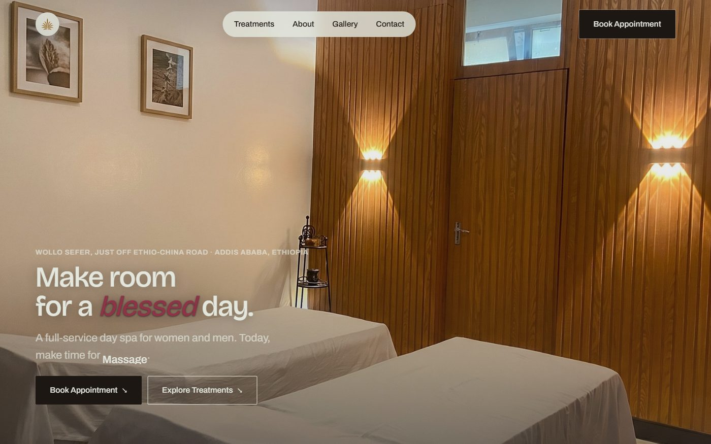
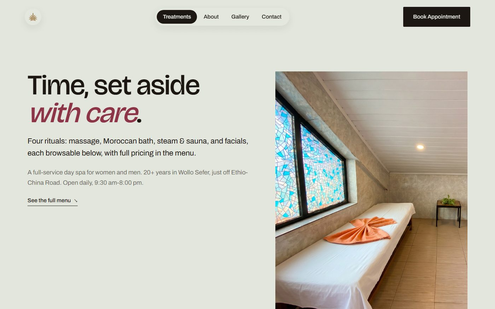
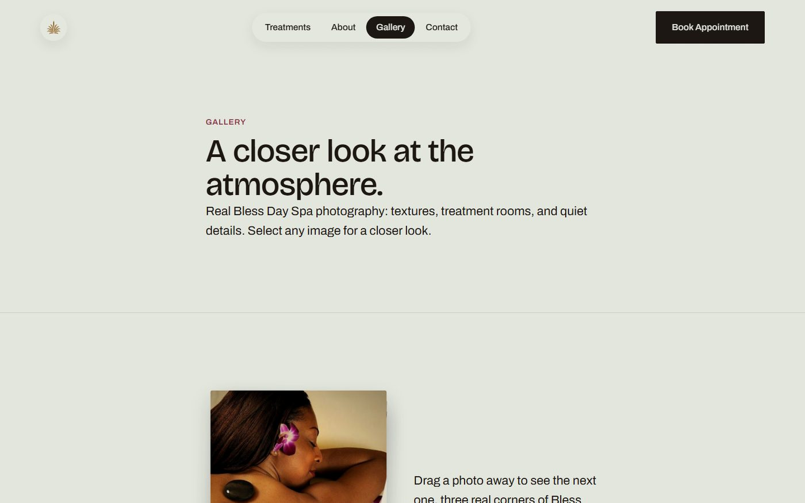
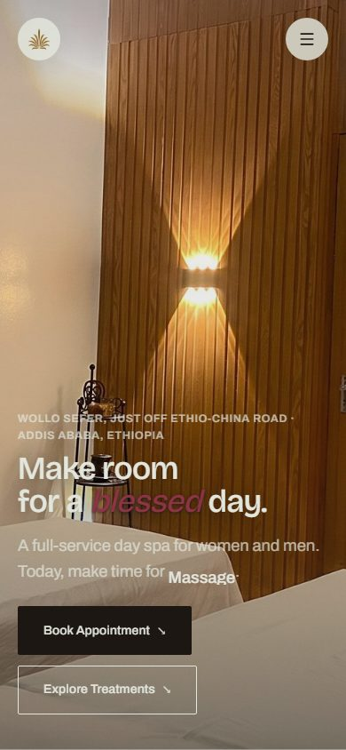

# Bless Day Spa

A marketing and lead-capture website for Bless Day Spa, a real, single-location
day spa in Wollo Sefer, Addis Ababa. It replaces an informal online presence
with a browsable treatment menu, real on-site photography, verified guest
reviews, and direct WhatsApp/phone contact for booking a visit.

Built with React, React Router, and Vite, styled with Tailwind CSS v4, and
deployed on Vercel with a Neon/Prisma-backed admin dashboard for managing
the menu.

## Screenshots

| Home | Treatments |
| --- | --- |
|  |  |

| Gallery | Home (mobile) |
| --- | --- |
|  |  |

## Features

- **Treatment menu** — Massage, Moroccan bath, steam & sauna, and facials,
  each with real pricing and a dedicated detail page.
- **Real photography** — on-site interior and treatment photos throughout
  (sourcing notes in [`src/content/images.ts`](src/content/images.ts)); only
  one page (facials) falls back to a disclosed, licensed stock photo.
- **Verified guest reviews** — pulled directly from the business's public
  Tripadvisor listing (see [`src/content/reviews.ts`](src/content/reviews.ts)).
- **Direct contact** — every "book" call to action opens a prefilled WhatsApp
  chat (with a tel: link as a fallback), since there's no live appointment
  calendar; the business confirms times by message or call.
- **Admin dashboard** (`/admin`) — a password-protected menu editor backed
  by Neon Postgres via Prisma, for updating treatments and pricing without a
  code change. See [`docs/admin-setup.md`](docs/admin-setup.md).
- **Responsive, animated UI** — GSAP/Motion-driven entrance and scroll
  animations, a plaster-and-rose visual system documented in
  [`DESIGN.md`](DESIGN.md), and reduced-motion support throughout.

## Tech stack

| Layer | Tooling |
| --- | --- |
| Framework | React 19 + React Router (SPA, Vite-built) |
| Styling | Tailwind CSS v4 |
| Animation | Motion (Framer Motion), GSAP |
| Backend | Vercel Functions (`api/*.ts`) |
| Database | Neon Postgres via Prisma (admin dashboard only) |
| File storage | Vercel Blob (admin-uploaded menu images) |
| Hosting | Vercel |

## Project structure

```
api/                  Vercel Functions — menu CRUD, admin auth
prisma/               Database schema, migrations, seed script
public/images/        Real site photography, organized by page
src/
  components/         UI building blocks, organized by section/page/admin
  content/            Typed content: business facts, reviews, treatment copy, image paths
  pages/              Route-level page components (incl. pages/admin/*)
  styles/global.css   The site's full design system (tokens, components, responsive rules)
docs/                 Setup guides (admin, database) and research notes
```

## Getting started

### Prerequisites

- Node.js 20+
- A [Neon](https://neon.tech) Postgres database (only needed for the `/admin`
  dashboard — the public site runs without it)

### Setup

```bash
npm install
cp .env.example .env.local   # fill in the values you need — see below
npm run dev                  # starts Vite + the local API dev server
```

The dev server runs the public site at `http://localhost:5173`. Vite's dev
server loads `api/*.ts` directly (via `vite-dev-api.ts`) so the admin
endpoints work locally without `vercel dev`.

### Environment variables

See [`.env.example`](.env.example) for the full list. None of these should
ever be prefixed `VITE_` or read from client code — they're server-only.

| Variable | Used for |
| --- | --- |
| `DATABASE_URL`, `DIRECT_URL`, `NEON_BRANCH` | Neon Postgres connection for the admin dashboard |
| `BLOB_READ_WRITE_TOKEN` | Vercel Blob storage for admin-uploaded images |
| `SESSION_SECRET` | Signs the admin session cookie |
| `ADMIN_EMAIL`, `ADMIN_PASSWORD` | Seeds the first admin login (`npm run prisma:seed` only) |

### Available scripts

| Command | Description |
| --- | --- |
| `npm run dev` | Start the local dev server (site + API) |
| `npm run build` | Type-check and build for production |
| `npm run preview` | Preview the production build locally |
| `npm run lint` | Run ESLint |
| `npm run prisma:generate` | Regenerate the Prisma client |
| `npm run prisma:migrate` | Run database migrations in dev |
| `npm run prisma:studio` | Open Prisma Studio |
| `npm run prisma:seed` | Create the first admin user |

## Documentation

- [`PRODUCT.md`](PRODUCT.md) — product purpose, positioning, and principles
- [`DESIGN.md`](DESIGN.md) — the visual design system (palette, type, components)
- [`docs/admin-setup.md`](docs/admin-setup.md) — setting up the admin dashboard
- [`docs/neon-prisma-setup.md`](docs/neon-prisma-setup.md) — database setup
- [`docs/research.md`](docs/research.md) — sourcing notes for every verified business fact

## Deployment

The site deploys to [Vercel](https://vercel.com). Pushing to `main` builds
via `npm run build` (`tsc -b && vite build`) and deploys the static site
alongside the `api/*.ts` Vercel Functions; `vercel.json` rewrites non-API,
non-asset routes to `index.html` for client-side routing.
